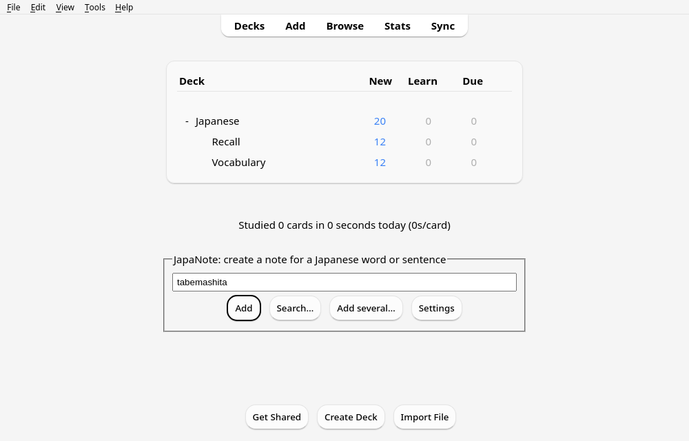
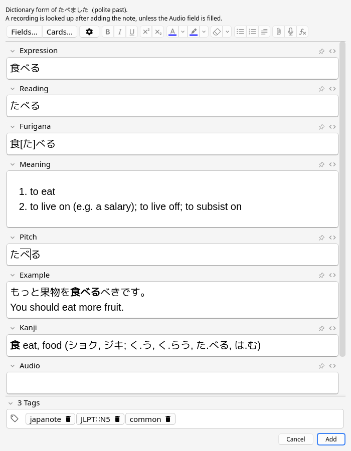

[Anki add-on](https://ankiweb.net/shared/info/171148684) to quickly make notes for Japanese words.

 

## Features

- Type a word in kanji, kana or romaji, and press Enter.
- Type a conjugated word to get its dictionary form (e.g. 食べました gives 食べる).
- Check the note in the editor of Anki, and change any field or tag, before adding it.
- Pick the word you want when several match.
- Look up proper nouns, and technical words on the Japanese Wikipedia.
- If nothing matches, you still get automatic furigana placement.
- Paste a list of words, or open a text or CSV file, and add them all at once.
- You can have each card of a new note go into a specific deck.
- Tag new notes with their JLPT level (e.g. `JLPT::N3`), and `common` for common words.

Available fields, for example for 暗記:

- kanji: 暗記
- kana: あんき
- furigana: 暗[あん]記[き]
- definition: memorization
- JMdict ID: EntL1586910
- pitch accent: あ‾んき
- audio: a recording by a native speaker, when there is one
- example sentence: この詩を暗記しましょう。 Let's learn this poem by heart.
- kanji details: 暗 darkness (アン; くら.い), 記 scribe (キ; しる.す)

## Dictionaries

- The add-on does not ship any dictionary.
- On first start, it downloads the main dictionary (about 10 MB).
- It downloads the names dictionary (about 5 MB) the first time it needs it.
- It updates both in the background, at most once a day, with small patches.
- It stores them in its `user_files` folder.

[A workflow](.github/workflows/dictionaries.yml) builds them every week with
[tools/build_dictionaries.py](tools/build_dictionaries.py). It publishes them in the
[dictionaries release](https://github.com/qsantos/JapaNote/releases/tag/dictionaries) (see
[japanote/package.py](japanote/package.py) for the format).

## Development

```sh
# build the dictionaries locally (about a minute)
python3 tools/build_dictionaries.py download sources
python3 tools/build_dictionaries.py build sources dist http://127.0.0.1:8000
python3 tools/build_dictionaries.py install dist db

# run the tests
JAPANOTE_DB_DIR=db uv run pytest

# use local dictionaries in Anki
(cd dist && python3 -m http.server 8000) &
JAPANOTE_MANIFEST_URL=http://127.0.0.1:8000/manifest-v1.json anki

# package the add-on
make -C japanote package
```

- The add-on must stay compatible with Python 3.9, which Anki 24.06 to 25.02 ship.
- The package can be installed with "Install from file…" in Anki. It replaces the version from AnkiWeb.
- AnkiWeb ignores `manifest.json`: set the oldest version of Anki (24.06) when uploading.
- [tools/e2e](tools/e2e/README.md) tests the add-on in a real Anki, and takes the screenshots.

## Credits

- [JMdict](https://www.edrdg.org/wiki/index.php/JMdict-EDICT_Dictionary_Project),
  [JMnedict](https://www.edrdg.org/enamdict/enamdict_doc.html) and
  [KANJIDIC2](https://www.edrdg.org/wiki/index.php/KANJIDIC_Project) are the property of the
  [Electronic Dictionary Research and Development Group](https://www.edrdg.org/), and are used in conformance with
  the Group's [licence](https://www.edrdg.org/edrdg/licence.html) (CC BY-SA 4.0)
- furigana from [JmdictFurigana](https://github.com/Doublevil/JmdictFurigana) (CC BY-SA 4.0)
- JLPT levels from [Jonathan Waller's lists](http://www.tanos.co.uk/jlpt/) (CC BY), matched to JMdict by
  [yomitan-jlpt-vocab](https://github.com/stephenmk/yomitan-jlpt-vocab) (CC BY-SA 4.0)
- the pitch accent notation was provided by Uros O. through his free database
  [Kanjium](https://github.com/mifunetoshiro/kanjium) (CC BY-SA 4.0)
- example sentences from [Tatoeba](https://tatoeba.org/) (CC BY 2.0 FR), chosen with the index of the words they
  contain (originally from the Tanaka Corpus)
- readings and translations of technical words from [Wikipedia](https://ja.wikipedia.org/) (CC BY-SA 4.0)
- recordings from [Lingua Libre](https://lingualibre.org/), hosted on Wikimedia Commons (mostly CC BY-SA 4.0; the
  name of the speaker is kept in the name of the file)
- sentences are analyzed with the IPA dictionary (© Nara Institute of Science and Technology), as compiled by
  [Janome](https://github.com/mocobeta/janome) (Apache 2.0), whose algorithm is reproduced in `japanote/analyzer.py`
  (see [NOTICE-IPADIC.txt](NOTICE-IPADIC.txt))
- romaji conversion by [python-romkan](https://github.com/soimort/python-romkan), a port of Ruby/Romkan by Satoru
  Takabayashi (Ruby's licence)
